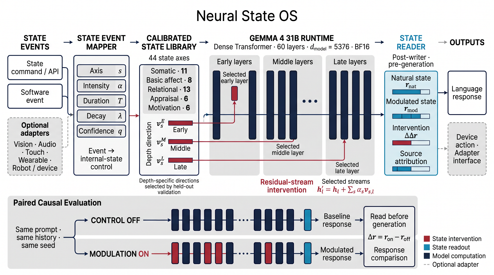

# Architecture

Neural State OS separates state control from language-level instruction. The
control path operates on model activations; the language prompt remains a
separate input channel.



## Runtime data path

1. A client submits a message and a sparse map of state-axis intensities.
2. The runtime validates the request and maps each active axis to three
   model-specific `(layer, direction, gain)` tuples.
3. Directions sharing a layer are composed. Raw addition is the frozen default;
   an optional RMS cap limits unusually constructive multi-axis sums while
   preserving their relative directions.
4. Residual writers apply the composed vector according to one of three scopes:
   `all_tokens`, `last_token`, or `generation_only`.
5. Before generation, the reader captures pooled residual states at selected
   post-writer layers.
6. A paired no-writer pass uses the identical prompt and history. The difference
   between writer-on and writer-off projections is reported as `writer_delta`.
7. The regularized attribution decoder maps the delta vector back to equivalent
   source-axis doses. Generation then proceeds with the requested writer state.

## Depth-specific control

Each axis has separate early, middle, and late directions. The directions were
selected independently within depth bands using cross-scene and cross-style
rank validity. The runtime therefore does not assume that one shared layer is
optimal for every state.

For axis `s` at layer `l`, the frozen writer applies

```text
h'_l = h_l + alpha_s * w_(s,l) * v_(s,l)
```

where `v_(s,l)` is the calibrated direction, `w_(s,l)=0.6` in the public
release, and `alpha_s` is the user-requested dose.

## Writer and reader separation

The writer bank and reader bank solve different problems:

- the **writer** stores directions chosen for controllable state intervention;
- the **reader** is constrained to a layer after the axis's last write, so it
  can observe the intervention without reading from an earlier causal point;
- the **attribution decoder** explains writer-induced deltas only and must not
  be applied to the total observed state.

This separation prevents the source-attribution inverse from erasing natural
co-activation in a prompt-conditioned state.

## Model-specific contracts

The 12B writer has shape `44 × 3 × 3840`; the 31B writer has shape
`44 × 3 × 5376`. Servers validate dimensions and layer ranges before serving.
Artifacts are not interchangeable across checkpoints or model sizes.

## External adapter boundary

The current public runtime accepts state commands through HTTP/UI requests.
Future sensor and embodiment adapters should map an external event to:

```text
axis, signed intensity, duration, decay, confidence, timestamp, provenance
```

The adapter layer must remain outside the model runtime and enforce rate,
conflict, authentication, and hardware-safety policies before issuing a state
event or device action.
