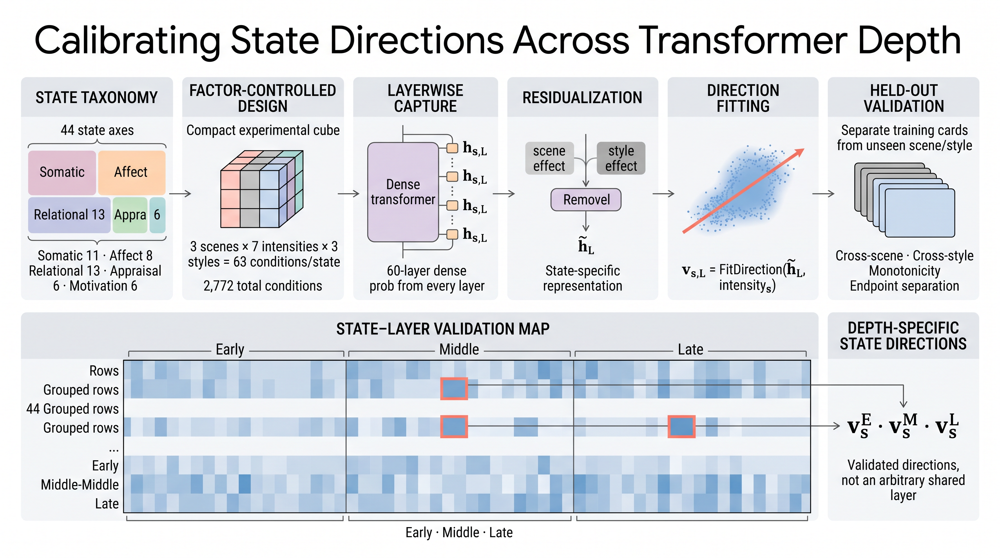
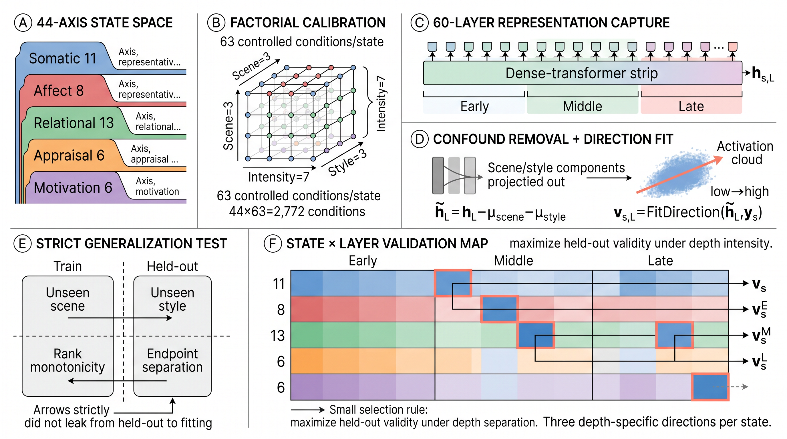

# Methods

## State-direction calibration

The frozen Direct-44 artifacts were derived from a controlled factorial design:

- 44 state axes;
- 3 scenes per axis;
- 7 ordered intensity levels;
- 3 writing styles;
- 63 conditions per axis and 2,772 conditions in total.

Residual activations were captured at every text-decoder layer. Scene and style
components were removed before fitting an intensity direction. Validity was
measured on held scene/style combinations using rank monotonicity and endpoint
separation.

*Figure M1. Conceptual calibration protocol. The released scientific metrics
come from the frozen artifacts and plotting scripts, not from values inferred
from this illustration.*

## Layer selection

For each axis, the best valid direction was selected independently from early,
middle, and late layer bands. The 12B model used 48 captured layers; the 31B
model used 60. The public writer stores all three directions and their layer
indices without forced cross-axis orthogonalization.

*Figure M2. Factorial capture, confound removal, and depth-specific selection.*

## Post-writer readout

The live reader is selected only from layers strictly later than an axis's
final writer layer. For each axis, projection values are centered on a neutral
reference and scaled by half the controlled endpoint separation.

At message time the server performs two forward observations:

1. same prompt and history, writer disabled;
2. same prompt and history, requested writer restored.

The returned fields distinguish:

- `value`: total observed projection after writing;
- `writer_delta`: paired writer-on minus writer-off change;
- `writer_attribution`: regularized source estimate from the complete delta
  vector.

The readout occurs after the message and before generation. Consequently,
`all_tokens` writes are visible at that point, while `last_token` and
`generation_only` writes have not yet been applied to a generated token.

## Source attribution

Writing one axis can move multiple readers because state directions are not
orthogonal. The calibration measures the full writer-to-reader response matrix.
A Tikhonov-regularized inverse then estimates equivalent source-axis doses.
This inverse is a control diagnostic; it is not a classifier for natural
conversation and is never used to rewrite the total state.

## Public release boundary

The repository distributes runtime code and small model-matched writer/reader
artifacts. It does not distribute the Gemma checkpoints, the generated
calibration corpus, or full layerwise activation matrices. The capture and
packaging code accepts user-supplied research data for independent rebuilding.
